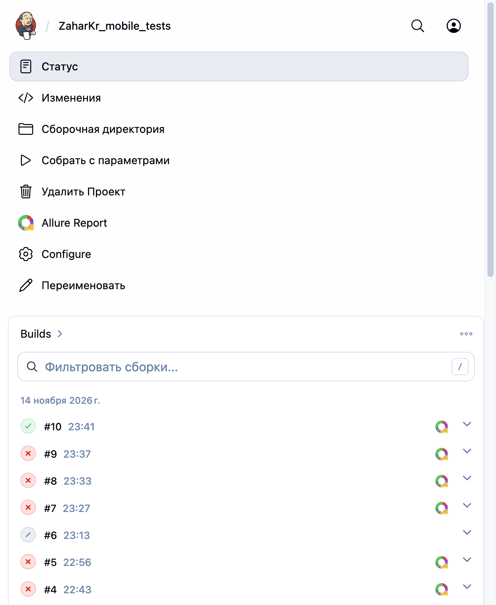
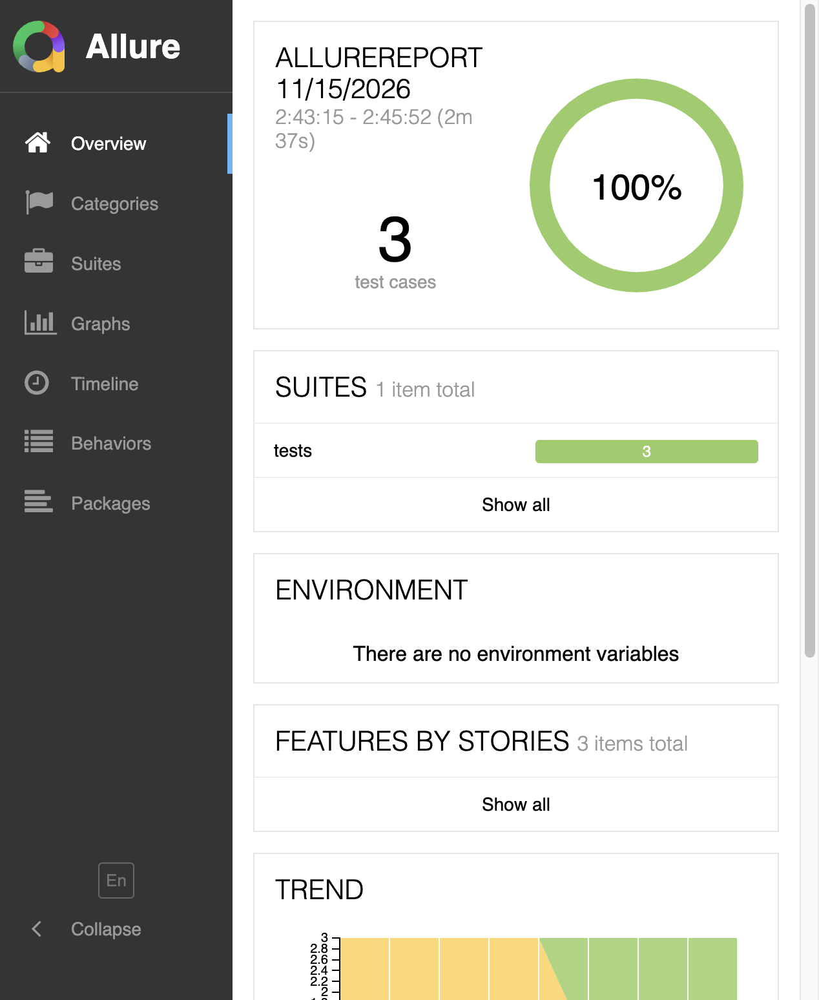
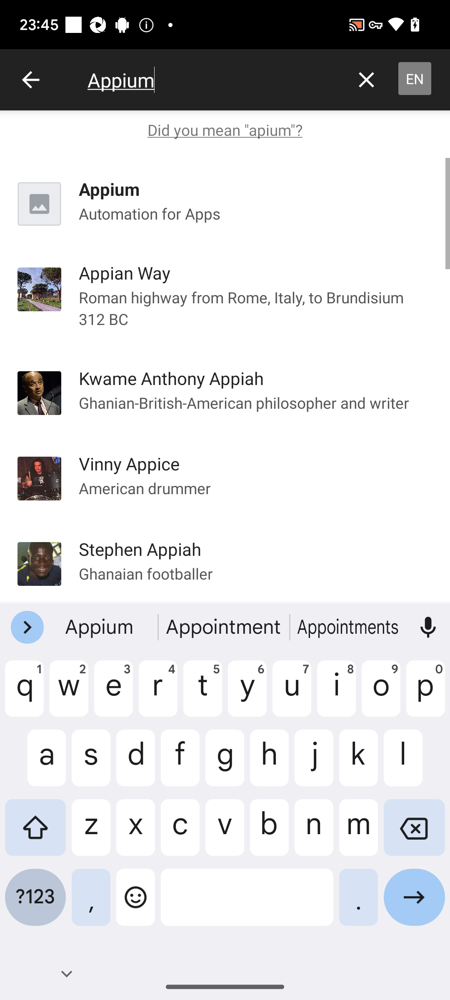

# Mobile — Wikipedia (Appium)

Автотесты Android Wikipedia: Appium, Pytest, Allure.  
Два окружения — **local** (эмулятор) и **BrowserStack**, конфиги на pydantic.


| | |
|---|---|
| GitHub | https://github.com/ZaharKr/mobile_tests |
| Jenkins | https://jenkins.qa.guru/job/ZaharKr_mobile_tests/ |
| Allure | https://jenkins.qa.guru/job/ZaharKr_mobile_tests/10/allure |
| UI + API | [toolshop_diploma](https://github.com/ZaharKr/toolshop_diploma) |

## Сценарии

| Файл | Что проверяет |
|------|---------------|
| `tests/test_search.py` | Поиск в Wikipedia |
| `tests/test_open_article.py` | Открытие статьи из выдачи |
| `tests/test_clear_search.py` | Очистка поля поиска |

## Конфиги

- `LocalConfig` — Appium local (`CONTEXT=local`)
- `BrowserStackConfig` — BrowserStack (`CONTEXT=bstack`)

Credentials — только `.env` (dotenv), в git не коммитятся.

## Установка

```bash
git clone https://github.com/ZaharKr/mobile_tests.git
cd mobile_tests
python3 -m venv .venv
source .venv/bin/activate
pip install -r requirements.txt
cp .env.example .env
```

В `.env` указать `BROWSERSTACK_USERNAME` / `BROWSERSTACK_ACCESS_KEY` и `BROWSERSTACK_APP`.

## Запуск

BrowserStack:

```bash
pytest --context=bstack
```

Local:

```bash
pytest --context=local
```

```bash
allure serve allure-results
```

В Allure: steps, screenshot, page source, video (BrowserStack).

## Jenkins

Freestyle, label `python`, Git на этот репозиторий.

1. Create Text File → `.env` с `BROWSERSTACK_*`
2. Shell:

```bash
python3 -m venv .venv
source .venv/bin/activate
pip install -r requirements.txt
pytest --context=bstack
```

3. Allure Report → `allure-results`

Последняя успешная сборка: [#10 SUCCESS — 3 passed](https://jenkins.qa.guru/job/ZaharKr_mobile_tests/10/)



## Allure Report



## Прохождение автотеста

Поиск → статья → очистка поля:


Скрин шага (BrowserStack):



## Telegram

Уведомление бота после прогона (Allure chart → Telegram):


## UI + API

Веб/API часть того же диплома: [toolshop_diploma](https://github.com/ZaharKr/toolshop_diploma).
