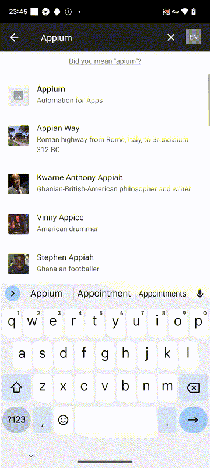
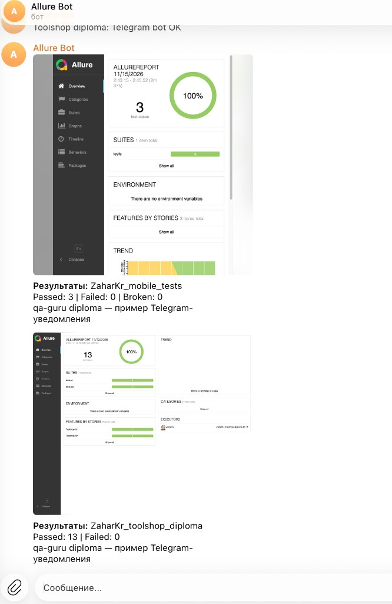

# Mobile — Wikipedia (Appium)

Автотесты Android Wikipedia: Appium, Pytest, Allure.  
Два окружения — **local** (эмулятор) и **BrowserStack**, конфиги на **pydantic** (`LocalConfig` / `BrowserStackConfig`).

### Используемые инструменты

<p align="left">
  
  
  
  
  
  
  
</p>

<p align="left">
  
  &nbsp;
  
  &nbsp;
  
  &nbsp;
  
</p>

| | |
|---|---|
| GitHub | https://github.com/ZaharKr/mobile_tests |
| Jenkins | https://jenkins.qa.guru/job/ZaharKr_mobile_tests/ |
| Allure | https://jenkins.qa.guru/job/ZaharKr_mobile_tests/10/allure |
| TestOps | https://allure.qa.guru/project/5432/test-cases |
| Jira | https://jira.qa.guru/browse/MUL-80 |
| UI + API | [toolshop_diploma](https://github.com/ZaharKr/toolshop_diploma) |

## Список проверок

1. Успешный поиск в Wikipedia.
2. Открытие статьи из результатов поиска.
3. Очистка поля поиска.

## Конфиги

- `LocalConfig` — Appium local (`CONTEXT=local` / `--context=local`)
- `BrowserStackConfig` — BrowserStack (`CONTEXT=bstack` / `--context=bstack`)

Credentials — только `.env` (dotenv), в git не коммитятся.

## Установка

```bash
git clone https://github.com/ZaharKr/mobile_tests.git
cd mobile_tests
python3 -m venv .venv
source .venv/bin/activate
pip install -r requirements.txt
cp .env.example .env
```

В `.env` указать `BROWSERSTACK_USERNAME` / `BROWSERSTACK_ACCESS_KEY` и `BROWSERSTACK_APP`.

## Запуск

BrowserStack:

```bash
pytest --context=bstack
```

Local:

```bash
pytest --context=local
```

```bash
allure serve allure-results
```

В Allure: steps, screenshot, page source, video (BrowserStack).

## Jenkins

> [Ссылка на сборку в Jenkins](https://jenkins.qa.guru/job/ZaharKr_mobile_tests/)

Freestyle, label `python`, Git на этот репозиторий.

1. Create Text File → `.env` с `BROWSERSTACK_*`
2. Shell:

```bash
python3 -m venv .venv
source .venv/bin/activate
pip install -r requirements.txt
pytest --context=bstack
```

3. Allure Report → `allure-results`
4. Telegram: allure-notifications **4.11.1**

Последняя успешная сборка: [#10 SUCCESS — 3 passed](https://jenkins.qa.guru/job/ZaharKr_mobile_tests/10/)


## Allure Report


## Allure TestOps / Jira

TestOps: https://allure.qa.guru/project/5432/test-cases  
Jira: [MUL-80](https://jira.qa.guru/browse/MUL-80)

## Прохождение автотеста

Поиск → статья → очистка поля:



Скрин шага (BrowserStack):


## Telegram

Уведомление бота после прогона (Allure chart → Telegram):



## UI + API

Веб/API часть того же диплома: [toolshop_diploma](https://github.com/ZaharKr/toolshop_diploma).
